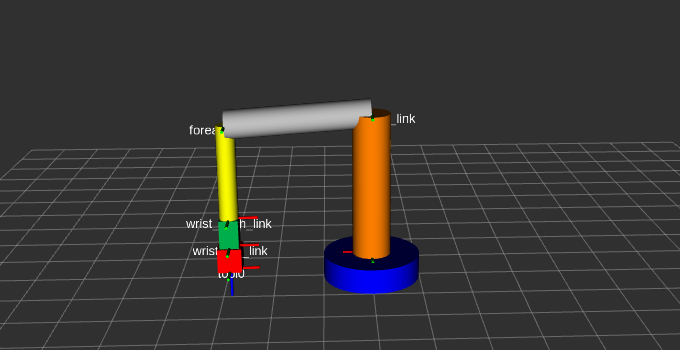
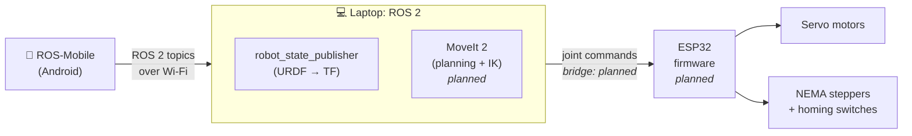

# Dum-E: A DOF-Scalable, 3D-Printed Robotic Arm

A from-scratch robotic arm built on **ROS 2**, driven by an **ESP32** with hobby servos and NEMA stepper motors, and controlled from an Android phone through **ROS-Mobile**. The design goal is *scalability*: adding a degree of freedom should mean adding one joint definition, not rewriting the stack.

> **Status:** 🚧 Work in progress. Robot description complete and audited; motion planning and hardware integration are next. See the [roadmap](#roadmap) and the [engineering log](docs/engineering-log.md).



---

## Why this project

I wanted to understand robot arms from the coordinate frames up, not by copying a tutorial package. Every design choice in this repository has a written reason in [`docs/design-decisions.md`](docs/design-decisions.md), and every bug worth learning from is recorded in [`docs/engineering-log.md`](docs/engineering-log.md).

## System architecture



## Current kinematic model

The reference build has **5 degrees of freedom**, all revolute: enough to place the gripper anywhere in reach, choose its approach angle, and rotate the fingers to match an object ([ADR-007](docs/design-decisions.md#adr-007-joint-layout-5-dof-reference-build)). Frames follow [REP-103](https://www.ros.org/reps/rep-0103.html) (X forward, Y left, Z up; SI units). At zero pose the arm points straight up and every frame is aligned with `base_link`.

| # | Joint | Motion | Axis (local) | Limits | Planned actuator |
|---|-------|--------|--------------|--------|------------------|
| 1 | `base_yaw_joint` | Base yaw | Z | ±180° | NEMA 17 stepper |
| 2 | `shoulder_pitch_joint` | Shoulder pitch | Y | ±120° | NEMA 17, geared |
| 3 | `elbow_pitch_joint` | Elbow pitch | Y | ±135° | NEMA 17 or strong servo |
| 4 | `wrist_pitch_joint` | Wrist pitch | Y | ±90° | Hobby servo |
| 5 | `wrist_roll_joint` | Wrist roll | Z | ±90° | Hobby servo |

Tool frame (`tool0`) at zero pose: **(0, 0, 0.96) m** above the mounting surface. With the gripper pointing straight down, the arm reaches the table between **0.07 and 0.45 m** from the base axis. Full derivation, sign conventions, singularity and workspace analysis: [`docs/kinematics.md`](docs/kinematics.md).

## Repository layout

```
.
├── my_arm_description/        ROS 2 package: URDF, launch file, RViz config
│   ├── urdf/my_arm.urdf
│   ├── launch/display.launch.py
│   ├── rviz/display.rviz
│   ├── CMakeLists.txt
│   └── package.xml
├── scripts/
│   ├── urdf_fk_check.py       Independent FK and Jacobian check of the URDF
│   └── table_reach.py         Table reachability sweep (closed-form IK)
└── docs/
    ├── engineering-log.md     Dated log: what was done, what broke, what I learned
    ├── design-decisions.md    Why each design choice was made (ADR format)
    ├── kinematics.md          Frames, joint table, FK, singularities
    └── images/
```

Planned packages: `my_arm_moveit_config/` (MoveIt 2), `my_arm_hardware/` (ros2_control interface), `firmware/esp32/`.

## Quick start

Developed on Ubuntu 24.04 LTS (dual-boot) with ROS 2 Jazzy Jalisco.

```bash
# one-time: put the repository inside your workspace's src/ folder
mkdir -p ~/ros2_ws/src && cd ~/ros2_ws/src
git clone https://github.com/navidirteja/dum-e-robotic-arm.git

# install dependencies declared in package.xml, then build
cd ~/ros2_ws
rosdep install --from-paths src --ignore-src -y
colcon build --packages-select my_arm_description
source install/setup.bash
ros2 launch my_arm_description display.launch.py
```

Move the sliders in the *Joint State Publisher* window to drive each joint in RViz2.

Verify the kinematics independently of ROS:

```bash
pip install numpy scipy
python3 scripts/urdf_fk_check.py my_arm_description/urdf/my_arm.urdf
python3 scripts/table_reach.py
```

## Roadmap

- [x] **Phase 1 — Digital model.** 4-DOF URDF, ROS 2 description package, RViz2 visualization
- [x] **Phase 2 — URDF audit and 5-DOF redesign.** REP-103 conventions, collision/inertial data, `tool0` frame, 5-DOF layout, numerical FK, Jacobian and workspace verification
- [ ] **Phase 3 — Scalable description.** Convert URDF to xacro with a `dof` parameter (3-, 4-, 5- and 6-DOF variants from one macro) and an optional linear rail (`rail:=true`)
- [ ] **Phase 4 — Motion planning.** MoveIt 2 configuration, named poses, IK
- [ ] **Phase 5 — Hardware interface.** ESP32 firmware, ROS 2 ↔ ESP32 bridge, homing
- [ ] **Phase 6 — Mechanical build.** 3D-printed parts, assembly, calibration
- [ ] **Phase 7 — Phone control.** ROS-Mobile teleoperation
- [ ] **Phase 8 — Demo.** Pick-and-place task, video
- [ ] **Phase 9 — Linear rail (stretch goal).** Prismatic base axis on V-slot extrusion

## Documentation

| Document | What it answers |
|----------|-----------------|
| [Engineering log](docs/engineering-log.md) | What happened, in order, including mistakes |
| [Design decisions](docs/design-decisions.md) | *Why* things are the way they are |
| [Kinematics](docs/kinematics.md) | The math behind the arm's motion |
